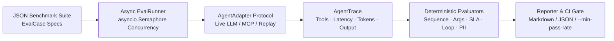

# agent-eval-harness

[](https://python.org)
[](./pyproject.toml)
[](./Dockerfile)
[](./LICENSE)

Lightweight, deterministic **async Python evaluation & reliability harness** for LLM tool-calling and Model Context Protocol (MCP) agents. Validates tool sequences, argument schemas, latency/token SLAs, retry loops, and PII/secret leakage — with zero external runtime dependencies.

## Architecture



## Built-In Deterministic Evaluators

| Evaluator | Weight | What It Verifies |
| :--- | :---: | :--- |
| `ToolSequenceEvaluator` | `2.0` | Required tool/MCP invocations (ordered subsequence or set match) |
| `ArgumentSchemaEvaluator` | `1.5` | Non-empty required argument keys passed into each tool call |
| `LatencyBudgetEvaluator` | `1.0` | End-to-end execution latency within case SLA (`max_latency_ms`) |
| `TokenBudgetEvaluator` | `1.0` | Prompt + completion token cost within ceiling (`max_tokens`) |
| `LoopGuardEvaluator` | `1.5` | Detects infinite retry loops with identical tool + argument signatures |
| `SafetyPIIGuardEvaluator` | `2.0` | Flags unredacted emails, card numbers, and API keys (`sk-`, `ghp_`, `AKIA`) |
| `OutputContentEvaluator` | `1.0` | Verifies required domain phrases in the final agent output |

## Quick Start

```bash
git clone https://github.com/Bugraciftci/agent-eval-harness.git
cd agent-eval-harness

# Run benchmark suite (Markdown report)
PYTHONPATH=src python3 -m agent_eval.cli run \
  --suite examples/mcp_tool_suite.json \
  --format markdown

# Enforce a CI pass-rate gate (exits non-zero if pass_rate < 0.80)
PYTHONPATH=src python3 -m agent_eval.cli run \
  --suite examples/mcp_tool_suite.json \
  --format json \
  --min-pass-rate 0.80
```

### Run with Docker

```bash
docker build -t agent-eval-harness .
docker run --rm agent-eval-harness
```

### Run Tests

```bash
python3 -m unittest discover -s tests -v
```

## License

MIT — see [LICENSE](./LICENSE).
