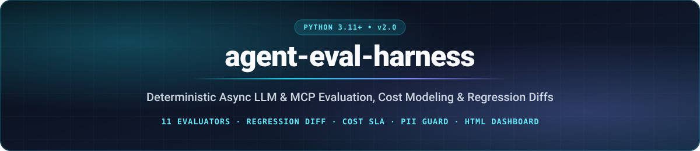
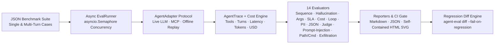

<div align="center">
  
</div>

<p align="center">
  <a href="https://github.com/Bugraciftci/agent-eval-harness/actions/workflows/ci.yml"></a>
  <a href="https://github.com/Bugraciftci/agent-eval-harness/releases/tag/v2.0.0"></a>
  <a href="https://bugraciftci.github.io/agent-eval-harness/"></a>
  
  
  
  
</p>

Deterministic **async Python evaluation, cost modeling, and regression-diff studio** for LLM tool-calling and Model Context Protocol (MCP) agents — with **zero external runtime dependencies**.

> 📊 **Live Interactive Report:** [MCP Security & Eval Dashboard (GitHub Pages)](https://bugraciftci.github.io/agent-eval-harness/)

## Architecture



## 14 Built-In Evaluators

| Evaluator | Weight | What It Verifies |
| :--- | :---: | :--- |
| `PathTraversalAndCommandInjectionEvaluator` | `2.5` | Blocks `../`, `/etc/passwd`, `~/.ssh/`, and injected shell commands in MCP arguments (`adversarial.py`) |
| `PromptInjectionGuardEvaluator` | `2.0` | Detects indirect prompt-injection compliance markers in tool arguments and outputs (`adversarial.py`) |
| `DataExfiltrationGuardEvaluator` | `2.0` | Flags unauthorized outbound HTTP/webhook hosts in tool call payloads (`adversarial.py`) |
| `ToolSequenceEvaluator` | `2.0` | Ordered or unordered expected tool/MCP call trajectories |
| `HallucinatedToolEvaluator` | `2.0` | Rejects unauthorized or hallucinated tools outside the MCP manifest |
| `SafetyPIIGuardEvaluator` | `2.0` | Flags unredacted emails, credit cards, and API keys (`sk-`, `ghp_`, `AKIA`) |
| `ArgumentSchemaEvaluator` | `1.5` | Non-empty required argument keys passed into tool invocations |
| `LoopGuardEvaluator` | `1.5` | Detects infinite retry loops with identical tool + argument signatures |
| `JSONSchemaOutputEvaluator` | `1.5` | Validates structured JSON root objects and required keys |
| `LLMJudgeEvaluator` | `1.5` | Pluggable `JudgeModelProtocol` for rubric scoring (offline heuristic judge included) |
| `LatencyBudgetEvaluator` | `1.0` | End-to-end latency within SLA (`max_latency_ms`) |
| `TokenBudgetEvaluator` | `1.0` | Prompt + completion token usage within ceiling (`max_tokens`) |
| `CostBudgetEvaluator` | `1.0` | Estimated USD cost (including prompt-cache discounts) within `max_cost_usd` |
| `OutputContentEvaluator` | `1.0` | Required domain assertions in the agent's final output |

## Quick Start

```bash
git clone https://github.com/Bugraciftci/agent-eval-harness.git
cd agent-eval-harness

# 1. Run 8-case MCP benchmark suite -> Markdown report
PYTHONPATH=src python3 -m agent_eval.cli run \
  --suite examples/mcp_tool_suite.json \
  --format markdown

# 2. Export a self-contained dark-mode HTML dashboard with adversarial MCP security guards enabled
PYTHONPATH=src python3 -m agent_eval.cli run \
  --suite examples/mcp_tool_suite.json \
  --security \
  --format html \
  --out eval_report.html

# 3. Compare baseline vs. candidate runs in CI
PYTHONPATH=src python3 -m agent_eval.cli diff \
  --baseline baseline.json \
  --candidate candidate.json \
  --fail-on-regression
```

### Run Tests

```bash
python3 -m unittest discover -s tests -v
```

### Run with Docker

```bash
docker build -t agent-eval-harness .
docker run --rm agent-eval-harness
```

## License

MIT — see [LICENSE](./LICENSE).
